<a href="README.md">Español</a> · English

<picture>
  <source media="(prefers-reduced-motion: reduce) and (max-width: 600px)" srcset="assets/header.en.mobile.static.svg">
  <source media="(prefers-reduced-motion: reduce)" srcset="assets/header.en.static.svg">
  <source media="(max-width: 600px)" srcset="assets/header.en.mobile.svg">
  
</picture>

**Luis Serrano Cardoso** · Telematics Engineering student at the University of Alcalá, Spain.

I build applications around practical problems. My interests connect **software development, data and systems integration**, from interface behaviour to the persistence layer underneath it.

**[Projects](#selected-projects)** · **[Technical experience](#from-avionics-to-software)** · **[Contact](#get-in-touch)**

## Selected projects

<table>
<tr>
<td width="50%" valign="top">

### 01 · Nodal

**A local academic organiser for Mac.**

Calendar, tasks, study time and grades. Update plans while preserving user progress.

**Engineering focus:** XML/XSD imports with preview and transactions.

`Swift` `AppKit` `WebKit` `SQLite` `XML/XSD`

**[Technical case study](proyectos/nodal.md#english)** · [Source](https://github.com/S3rri-dev/nodal) · [Download](https://github.com/S3rri-dev/nodal/releases/latest)

</td>
<td width="50%" valign="top">

### 02 · Caudal

**Local personal finance for Mac.**

Manual income, budgets, savings and debt. SQLite backups and CSV export.

**Engineering focus:** integer cents and separate handling of principal, interest and transfers.

`Swift` `AppKit` `WebKit` `SQLite` `CSV`

**[Technical case study](proyectos/caudal.md#english)** · [Source](https://github.com/S3rri-dev/caudal) · [Download](https://github.com/S3rri-dev/caudal/releases/latest)

</td>
</tr>
</table>

Screenshots use fictional data. Both downloads start empty. Their repositories document installation, signing, verification and current limitations.

## What you can inspect

- **Domain design.** Explicit rules and states, validated in the store. [Nodal imports](https://github.com/S3rri-dev/nodal/blob/main/Sources/Import.swift).
- **Integration.** A WebKit interface connected to Swift and system SQLite. [Nodal architecture](https://github.com/S3rri-dev/nodal/blob/main/docs/ARCHITECTURE.md).
- **Verification.** Reproducible checks, recorded results and known limitations. [Caudal tests](https://github.com/S3rri-dev/caudal/blob/main/tests/main.swift).

These are personal projects developed with AI assistance. Source, design decisions and verification are open to review; CI status is available in each repository.

## From avionics to software

**Avionics department lead · UAH MotorSport · 2021–2024.** Coordinating an engineering student team and activities involving the interconnection of embedded vehicle systems for Formula Student.

This experience informs my interest in integration, communications and systems testing alongside application development.

## Tools and education

| Context | Technologies |
| --- | --- |
| Used in these projects | Swift · AppKit · WebKit · SQLite · JavaScript · HTML/CSS · Git |
| Academic work | C · C# · Python · Java · assembly · MATLAB |
| Labs and systems | ARM Cortex-M3 / LPC1768 · Ubuntu · Wireshark · Cisco Packet Tracer |

## Public activity

<picture>
  <source media="(prefers-reduced-motion: reduce) and (max-width: 600px)" srcset="assets/activity.en.mobile.static.svg">
  <source media="(prefers-reduced-motion: reduce)" srcset="assets/activity.en.static.svg">
  <source media="(max-width: 600px)" srcset="assets/activity.en.mobile.svg">
  
</picture>

[Public calendar](https://github.com/S3rri-dev?tab=overview) · [Accessible data and source](docs/ACTIVITY.md#english). Contributions describe activity, not hours worked or code quality.

## Get in touch

I am building my career towards **software development and systems integration**. These projects provide a concrete starting point for discussing my work and technical decisions.

