Español · <a href="README.en.md">English</a>

**Luis Serrano Cardoso** · Estudiante de Ingeniería Telemática en la Universidad de Alcalá.

Construyo aplicaciones para resolver problemas concretos. Me interesa conectar **desarrollo de software, datos e integración de sistemas**, desde el comportamiento de una interfaz hasta la persistencia que la sostiene.

**[Proyectos](#proyectos-destacados)** · **[Experiencia técnica](#de-la-aviónica-al-software)** · **[LinkedIn](https://www.linkedin.com/in/luis-serrano-cardoso-51809419b/)** · **[Contacto](mailto:s3rri.dev@gmail.com)**

## Proyectos destacados

<table>
<tr>
<td width="50%" valign="top">

### 01 · Nodal

**Organización académica local para Mac.**

Calendario, tareas, estudio y notas. Actualización de planes sin perder el progreso.

**Reto técnico:** importaciones XML/XSD con vista previa y transacciones.

`Swift` `AppKit` `WebKit` `SQLite` `XML/XSD`

**[Caso técnico](proyectos/nodal.md)** · [Código](https://github.com/S3rri-dev/nodal) · [Descarga](https://github.com/S3rri-dev/nodal/releases/latest)

</td>
<td width="50%" valign="top">

### 02 · Caudal

**Finanzas personales locales para Mac.**

Registro manual de ingresos, presupuestos, ahorro y deudas. Copias SQLite y exportación CSV.

**Reto técnico:** céntimos enteros y separación de principal, intereses y transferencias.

`Swift` `AppKit` `WebKit` `SQLite` `CSV`

**[Caso técnico](proyectos/caudal.md)** · [Código](https://github.com/S3rri-dev/caudal) · [Descarga](https://github.com/S3rri-dev/caudal/releases/latest)

</td>
</tr>
</table>

Las imágenes muestran datos ficticios. Las dos descargas empiezan vacías. Cada repositorio documenta instalación, firma, pruebas y límites de su versión vigente.

## Qué puedes revisar

- **Diseño de dominio.** Reglas y estados explícitos, con validación en el almacén. [Importaciones de Nodal](https://github.com/S3rri-dev/nodal/blob/main/Sources/Import.swift).
- **Integración.** Interfaz WebKit, puente Swift y SQLite del sistema. [Arquitectura de Nodal](https://github.com/S3rri-dev/nodal/blob/main/docs/ARCHITECTURE.md).
- **Verificación.** Comprobaciones reproducibles, resultados y límites documentados. [Pruebas de Caudal](https://github.com/S3rri-dev/caudal/blob/main/tests/main.swift).

Son proyectos personales desarrollados con asistencia de IA. El código, las decisiones y las comprobaciones están disponibles para revisión; el estado de CI se consulta en cada repositorio.

## De la aviónica al software

**Responsable del departamento de aviónica · UAH MotorSport · 2021–2024.** Coordinación de un equipo de estudiantes de ingeniería y actividades de interconexión de sistemas empotrados para Formula Student.

Esa experiencia orienta mi interés por la integración, las comunicaciones y las pruebas de sistemas, además del desarrollo de aplicaciones.

## Herramientas y formación

| Contexto | Tecnologías |
| --- | --- |
| En estos proyectos | Swift · AppKit · WebKit · SQLite · JavaScript · HTML/CSS · Git |
| Formación académica | C · C# · Python · Java · ensamblador · MATLAB |
| Laboratorio y sistemas | ARM Cortex-M3 / LPC1768 · Ubuntu · Wireshark · Cisco Packet Tracer |

## Hablemos

Estoy orientando mi carrera hacia oportunidades de **desarrollo de software e integración de sistemas**. Este perfil reúne proyectos que permiten revisar mi trabajo y conversar sobre sus decisiones técnicas.

**[s3rri.dev@gmail.com](mailto:s3rri.dev@gmail.com)** · **[LinkedIn](https://www.linkedin.com/in/luis-serrano-cardoso-51809419b/)**

