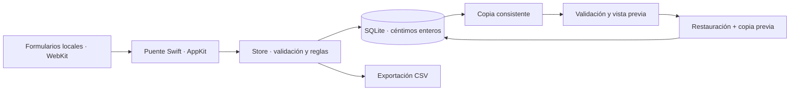

# Caudal · modelar el dinero sin alterar su significado

[Perfil](../README.md) · [Repositorio](https://github.com/S3rri-dev/caudal) · [English](#english)

## Problema

Sumar entradas y restar salidas no basta para explicar unas finanzas. Una transferencia entre cuentas, una disposición de préstamo y un ingreso aumentan o reducen saldos de formas distintas. Una reserva de ahorro representa un compromiso sobre dinero existente.

Caudal modela esos conceptos de forma explícita, con registro manual y validación en el almacén Swift. La interfaz presenta el resultado; las reglas no dependen solo de los formularios.

## Arquitectura

[Arquitectura completa](https://github.com/S3rri-dev/caudal/blob/main/docs/ARCHITECTURE.md) · [Especificación del dominio](https://github.com/S3rri-dev/caudal/blob/main/docs/ESPECIFICACION.md).

## Invariantes concretas

| Caso | Comportamiento esperado | Dónde revisarlo |
| --- | --- | --- |
| Transferir 200 € entre dos cuentas | Cambian ambos saldos; el saldo agregado y los ingresos/gastos no cambian | [Store.swift](https://github.com/S3rri-dev/caudal/blob/main/Sources/Store.swift) |
| Registrar una cuota de 110 €, con 100 € de principal | La deuda baja 100 €; los otros 10 € se tratan como intereses/comisiones | [Pruebas del almacén](https://github.com/S3rri-dev/caudal/blob/main/tests/main.swift) |
| Reservar saldo para un objetivo | No se crea dinero ni se genera una transferencia; se valida disponibilidad y meta | [Especificación](https://github.com/S3rri-dev/caudal/blob/main/docs/ESPECIFICACION.md) |
| Restaurar una base incompatible o corrupta | Se rechaza antes de reemplazar la base válida | [Pruebas de restauración](https://github.com/S3rri-dev/caudal/blob/main/tests/main.swift) |

Los importes se guardan como **céntimos enteros**. También se rechazan principal superior al pago, amortización superior a la deuda pendiente y referencias incoherentes. Editar o borrar movimientos debe respetar las cuotas posteriores.

## Recorrido de revisión

1. Lee las reglas públicas de [ESPECIFICACION.md](https://github.com/S3rri-dev/caudal/blob/main/docs/ESPECIFICACION.md).
2. Revisa la validación de movimientos, cálculo de saldos y restauración en [Store.swift](https://github.com/S3rri-dev/caudal/blob/main/Sources/Store.swift).
3. Contrasta los casos válidos y rechazos en [tests/main.swift](https://github.com/S3rri-dev/caudal/blob/main/tests/main.swift), el [aislamiento de ediciones](https://github.com/S3rri-dev/caudal/blob/main/tests/isolation.sh) y el [informe de verificación](https://github.com/S3rri-dev/caudal/blob/main/docs/VERIFICACION.md).

En un Mac con las herramientas indicadas en el repositorio:

    git clone https://github.com/S3rri-dev/caudal.git
    cd caudal
    ./scripts/build.sh
    ./tests/run.sh
    ./tests/run-ui.sh
    ./tests/isolation.sh
    python3 scripts/audit_publication.py --bundle dist/Caudal.app

La comprobación de interfaz abre AppKit/WebKit real y requiere sesión gráfica. Los datos de prueba son ficticios y están separados de los del usuario.

## Compromisos y límites

El enfoque local elimina la necesidad de cuentas de acceso y de un servidor. A cambio, el registro y las copias son manuales: no hay conexión bancaria ni sincronización entre dispositivos. SQLite no tiene cifrado propio de Caudal.

La publicación inicial está firmada ad hoc, sin Developer ID ni notarización. No se presenta como un producto auditado financieramente ni como software probado en todos los Mac. El resultado de [CI](https://github.com/S3rri-dev/caudal/actions/workflows/ci.yml) y las pruebas locales se consultan por separado en el repositorio.

Proyecto personal desarrollado con asistencia de IA. Las decisiones y resultados de esta ficha remiten a la implementación y a las comprobaciones documentadas.

## English

**Engineering focus: preserving the meaning of money across different operations.**

Caudal is a local personal finance application built with Swift, AppKit, WebKit and system SQLite. It stores monetary amounts as integer cents and validates domain rules in the Swift store.

Transfers affect individual account balances without changing aggregate income or expenses. Debt payments separate principal from interest. Savings reservations earmark existing funds without moving money. Invalid references, fractional cents and repayments exceeding outstanding principal are rejected. Historical edits must keep later payments valid.

Backups use SQLite. Restoration validates the candidate database and presents a preview before replacement, preserving a backup of the previous state.

Review [Store.swift](https://github.com/S3rri-dev/caudal/blob/main/Sources/Store.swift), [store tests](https://github.com/S3rri-dev/caudal/blob/main/tests/main.swift), [architecture](https://github.com/S3rri-dev/caudal/blob/main/docs/ARCHITECTURE.md) and [verification](https://github.com/S3rri-dev/caudal/blob/main/docs/VERIFICACION.md). Reproduction commands are listed above; native UI checks require a graphical macOS session.

This personal project was developed with AI assistance. Entry is manual; there is no bank integration or cross-device sync. The database has no application-level encryption. Initial signing is ad hoc, without notarisation. Local checks and CI are separate evidence, not a financial or exhaustive security audit.
