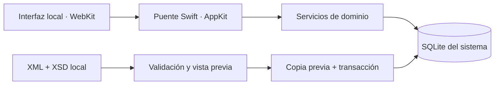

# Nodal · actualizar un plan sin perder el trabajo realizado

[Perfil](../README.md) · [Repositorio](https://github.com/S3rri-dev/nodal) · [English](#english)

## Problema

Un organizador académico mezcla datos que cambian a ritmos distintos: un plan puede actualizar fechas y tareas, mientras el usuario registra tiempo, dudas y resultados. Reemplazar todo el estado por el último archivo importado destruiría información válida.

Nodal mantiene separados **el plan, las ediciones locales y los registros del usuario**. Una fecha pasada no marca por sí sola una tarea como completada ni acredita aprendizaje.

## Arquitectura

La aplicación carga recursos del bundle y guarda datos fuera de él. La separación entre interfaz, servicios y almacén permite validar las operaciones en Swift y mantener SQLite como fuente de verdad. [Arquitectura completa](https://github.com/S3rri-dev/nodal/blob/main/docs/ARCHITECTURE.md).

## Tres decisiones que merece la pena revisar

| Decisión | Motivo | Implementación |
| --- | --- | --- |
| Importar con validación, vista previa y transacción | Detectar referencias y conflictos antes de modificar la base; evitar cambios parciales | [Import.swift](https://github.com/S3rri-dev/nodal/blob/main/Sources/Import.swift) |
| Hacer idempotente cada revisión del plan | Repetir la misma importación no debe duplicar datos; una baja requiere archivo explícito | [Contrato XML](https://github.com/S3rri-dev/nodal/blob/main/docs/XML.md) |
| Calcular tiempo desde segmentos y marcas temporales | Los ticks de la interfaz no son una fuente fiable de tiempo; los intervalos dudosos deben quedar fuera | [Timer.swift](https://github.com/S3rri-dev/nodal/blob/main/Sources/Timer.swift) |

El XML se valida con XSD local y límites de tamaño/profundidad; DTD, entidades y recursos externos se rechazan. Las copias utilizan SQLite. Estos controles no equivalen a una auditoría exhaustiva de seguridad.

## Recorrido de revisión

1. Lee el [XML de ejemplo](https://github.com/S3rri-dev/nodal/blob/main/examples/plan-demo.xml) y su [XSD](https://github.com/S3rri-dev/nodal/blob/main/Resources/xml/plan-v1.xsd).
2. Revisa previewXML, previewItems y applyImport en [Import.swift](https://github.com/S3rri-dev/nodal/blob/main/Sources/Import.swift): conflicto, copia, transacción e importación repetida.
3. Contrasta el comportamiento con las [pruebas Swift](https://github.com/S3rri-dev/nodal/blob/main/tests/main.swift), las de [planificación](https://github.com/S3rri-dev/nodal/blob/main/tests/features.swift) y el [informe de verificación](https://github.com/S3rri-dev/nodal/blob/main/docs/VERIFICATION.md).

En un Mac con las herramientas indicadas en el repositorio:

    git clone https://github.com/S3rri-dev/nodal.git
    cd nodal
    ./tests/run.sh
    ./tests/run-ui.sh
    ./scripts/build.sh

## Compromisos y límites

Swift/AppKit y las bibliotecas del sistema permiten una aplicación autónoma para Apple Silicon. WebKit facilita una interfaz HTML/CSS/JavaScript, a cambio de mantener un puente nativo y comprobar su integración.

La publicación inicial tiene firma ad hoc, sin Developer ID ni notarización. El objetivo de compilación no acredita pruebas físicas en todas las versiones de macOS. Las pruebas locales y las ejecuciones de [CI](https://github.com/S3rri-dev/nodal/actions/workflows/ci.yml) son evidencias diferentes; su estado vigente se documenta en el repositorio.

Proyecto personal desarrollado con asistencia de IA. Las decisiones y resultados de esta ficha remiten a la implementación y a las comprobaciones documentadas.

## English

**Engineering focus: importing a changing plan while preserving user records.**

Nodal is a local academic organiser built with Swift, AppKit, WebKit and system SQLite. Plans, local edits and user progress have separate ownership. Updating a plan must preserve study time, doubts and results.

The import pipeline validates XML against a local XSD, checks references and conflicts, presents a preview, makes a consistent backup and applies changes transactionally. Repeating an identical revision is idempotent. Archive operations are explicit. External XML resources, DTDs and entities are rejected.

Study time is calculated from timestamped segments instead of JavaScript ticks. The app excludes pauses and uncertain absence intervals; a completed task does not automatically establish mastery.

Start with [Import.swift](https://github.com/S3rri-dev/nodal/blob/main/Sources/Import.swift), [Timer.swift](https://github.com/S3rri-dev/nodal/blob/main/Sources/Timer.swift), the [architecture](https://github.com/S3rri-dev/nodal/blob/main/docs/ARCHITECTURE.md) and [verification report](https://github.com/S3rri-dev/nodal/blob/main/docs/VERIFICATION.md). Reproduction commands are listed above.

This personal project was developed with AI assistance. The initial release uses ad hoc signing and is not notarised. Local verification and remote CI are reported separately; neither implies exhaustive security review or testing on every supported macOS version.
