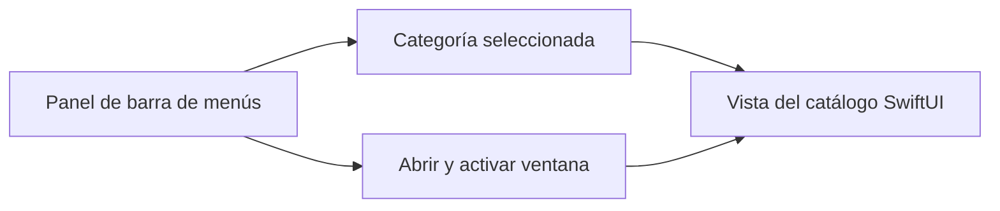

# Umbral · conectar la barra de menús con una app nativa

[Perfil](../README.md) · [Repositorio](https://github.com/S3rri-dev/umbral) · [Descarga](https://github.com/S3rri-dev/umbral/releases/latest) · [English](#english)

Umbral reúne fichas de utilidades en un catálogo para Mac. La edición pública descrita aquí incluye bienvenida, búsqueda, biblioteca, panel rápido y ajustes de apariencia. Las fichas de cierre de aplicaciones, maximización y mezcla de audio aparecen marcadas **En preparación**. [Alcance de la edición publicada](https://github.com/S3rri-dev/umbral/releases/tag/v1.0.0).

## De un clic a la categoría correcta

Al pulsar **Ver catálogo** en la barra de menús, el panel escribe la categoría elegida en la selección compartida, solicita la ventana `catalog` mediante `openWindow` y activa la aplicación con AppKit. Así, elegir Audio en el panel lleva directamente a Audio en la ventana principal. [Implementación del panel](https://github.com/S3rri-dev/umbral/blob/v1.0.0/Sources/MacUtilities/QuickPanel.swift).

| Decisión | Qué se puede revisar |
| --- | --- |
| Compartir la selección entre las dos superficies | `MenuBarExtra` y la ventana se coordinan desde la entrada de la app. [Arquitectura](https://github.com/S3rri-dev/umbral/blob/v1.0.0/docs/ARCHITECTURE.md) |
| Separar tema y acento | El usuario puede elegir un tema y conservar el acento de macOS, o ajustar cada preferencia por separado. `AppStorage` conserva las preferencias localmente. [Ajustes de apariencia](https://github.com/S3rri-dev/umbral/blob/v1.0.0/Sources/MacUtilities/GeneralPreferences.swift) · [Datos](https://github.com/S3rri-dev/umbral/blob/v1.0.0/docs/DATA.md) |
| Definir las fichas en el catálogo | Cada ficha tiene categoría, descripción y ejemplo. El catálogo utiliza esas definiciones para presentar las herramientas previstas. [Modelo del catálogo](https://github.com/S3rri-dev/umbral/blob/v1.0.0/Sources/MacUtilities/Catalog.swift) |

## Comprobaciones

La CI de `main` compiló y comprobó el bundle ARM64 desde un ejecutor Intel con macOS 26. El registro del proyecto documenta por separado la revisión nativa en Apple Silicon y macOS 27.0.1. La descarga tiene firma ad hoc. La notarización y la ejecución en macOS 14 figuran pendientes. [Ejecución de CI](https://github.com/S3rri-dev/umbral/actions/runs/42267523461) · [Registro de verificación](https://github.com/S3rri-dev/umbral/blob/v1.0.0/docs/VERIFICATION.md).

## English

Umbral is a native utility catalogue for Mac. The published edition covers onboarding, search, a library, a quick menu bar panel and appearance settings. Quit-on-close, window maximisation and the audio mixer are marked **In preparation**. [Published release scope](https://github.com/S3rri-dev/umbral/releases/tag/v1.0.0).

Choosing **View catalogue** in the menu bar panel updates the shared category selection, opens the `catalog` SwiftUI window and activates the app through AppKit. The catalogue model gives each utility a category, description and example. Theme and accent are separate preferences stored locally with `AppStorage`. [Quick panel](https://github.com/S3rri-dev/umbral/blob/v1.0.0/Sources/MacUtilities/QuickPanel.swift) · [Architecture](https://github.com/S3rri-dev/umbral/blob/v1.0.0/docs/ARCHITECTURE.md).

CI built and checked the ARM64 bundle on an Intel macOS 26 runner. The project records a separate native review on Apple Silicon running macOS 27.0.1. The download is ad hoc signed. Notarisation and runtime testing on macOS 14 remain pending. [CI run](https://github.com/S3rri-dev/umbral/actions/runs/42267523461) · [Verification record](https://github.com/S3rri-dev/umbral/blob/v1.0.0/docs/VERIFICATION.md).
